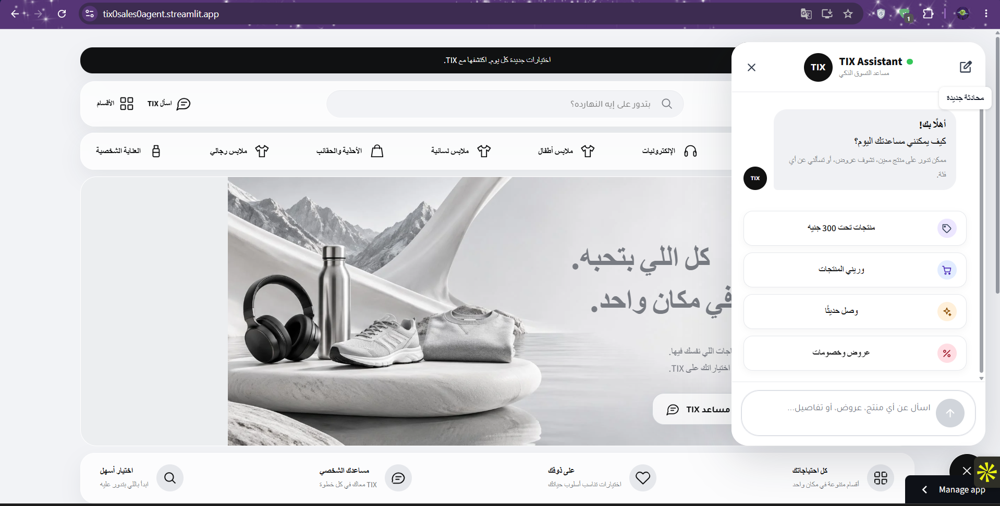
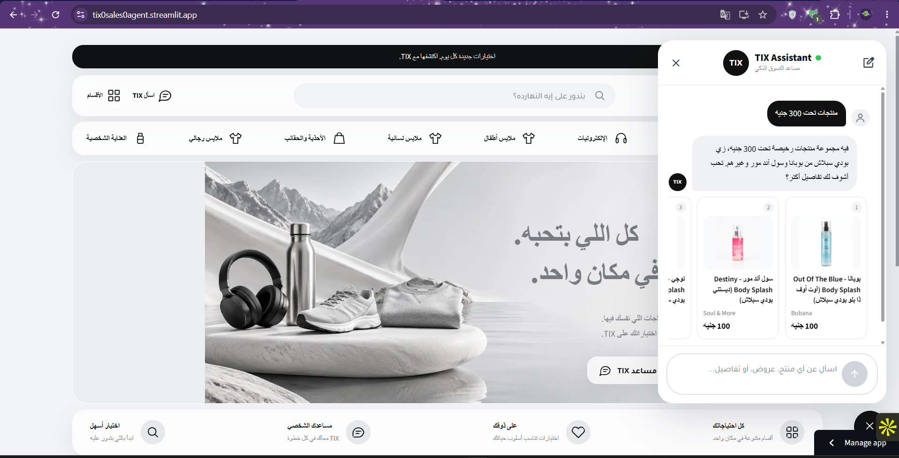

<div align="center">

<br>

[](https://tix0sales0agent.streamlit.app/)

<br>

[](https://python.org)
[](https://tix0sales0agent.streamlit.app/)
[](https://github.com/langchain-ai/langgraph)
[](https://groq.com)
[](#-how-it-works)

<br>

> **Tell it your budget and what you need. Get 2–3 real products from the live TIX catalog — in Egyptian Arabic.**

> **No hardcoded products. No made-up prices. Every answer comes from the TIX API.**

<br>

| 🕸️ Orchestration | ⚡ LLM | 🛒 Source of Truth | 🔎 Retrieval | 🗣️ Language | 🖥️ UI |
|:-----------------:|:------:|:------------------:|:------------:|:-----------:|:-----:|
| **LangGraph** | **Groq** (model configurable) | **TIX API (live)** | **Hybrid: embeddings + taxonomy routing + LLM judge** | **Egyptian Arabic · Arabic/English mix** | **Streamlit** |

<br>

### [🚀 Try the Live App →](https://tix0sales0agent.streamlit.app/)

</div>

---

## ✦ App Preview

<table>
  <tr>
    <td width="50%" align="center">
      
    </td>
    <td width="50%" align="center">
      
    </td>
  </tr>
</table>

---

## ✦ What is This?

Shopping on a big catalog usually means scrolling, filtering, and guessing keywords. **TIX Sales Agent** replaces that with a conversation.

A customer types the way they actually talk — *"ميزانيتي 300 جنيه وعايز حاجة للشعر"* — and the agent figures out what they need, finds matching products in the **live TIX catalog**, and recommends the best two or three with the real price and discount, like a good sales assistant would.

The LLM is the **conversational brain**. The TIX API is the **only source of truth**. The agent never recommends a product, price, or brand that didn't come back from the API, and it remembers the conversation, so follow-ups like *"غالي أوي، في أرخص؟"* just work.

---

## ✦ Example

> *Illustrative conversation — real answers always depend on the live catalog at that moment.*

```
Customer : ميزانيتي 300 جنيه وعايز حاجة للشعر
Agent    : شامبو نيزورال 2% المضاد للقشرة – 80 جنيه – مضاد قشرة
           شامبو Eva بالألوفيرا وزيت الأرجان – 80 جنيه – ترطيب
           تحب تشتري أي واحد منهم ولا محتاج حاجة تانية؟ 😊

Customer : عايز نستله
Agent    : للأسف مفيش منتجات نستله دلوقتي عندنا، تحب أدورلك على حاجة تانية؟
```

---

## ✦ How It Works

| Step | What Happens |
|:-----|:-------------|
| **1. Understand** | The LLM reads the message together with the conversation so far — budget, preferences, and what was already shown |
| **2. Route** | The need is mapped onto the **live** category / subcategory tree fetched from the API — no hardcoded synonyms or product mappings |
| **3. Retrieve** | Hybrid retrieval over the live catalog: API search & filters combined with embeddings |
| **4. Judge** | An LLM judge drops results that don't actually fit the request (keyword search alone is noisy) |
| **5. Answer** | A short, natural reply in Egyptian Arabic: 2–3 picks, real price after discount, one clear next step |

---

## ✦ Design Principles

| Principle | What it means |
|:----------|:--------------|
| 🧠 **LLM as the brain** | Understanding, context, and tone come from the model, not from rule tables |
| 🛒 **API as the truth** | Prices, discounts, stock, and categories are always read live, so new products appear without any change |
| 🚫 **Never hallucinate** | If it isn't in an API result, the agent doesn't say it |
| 💬 **Remembers context** | Multi-turn conversation; follow-ups refer back to earlier turns |
| 🌍 **Arabic-first, mixed-language friendly** | Handles Egyptian Arabic, English brand names, and both in one sentence |
| 🧩 **Simple & maintainable** | Small modules, no over-engineered graph nodes |

---

## ✦ Project Structure

```
TIX/
├── app.py                  ← Streamlit entry point
├── chat_cli.py             ← Talk to the agent from the terminal
├── config.py               ← Settings: model, API base URL, limits
├── requirements.txt
├── pytest.ini
├── scenarios.txt           ← Conversation scenarios for manual checks
│
├── agent/                  ← Agent logic (LangGraph pipeline, prompts)
├── tix/                    ← TIX API layer (live catalog access)
├── ui/                     ← Streamlit interface components
├── tests/                  ← Automated tests
├── docs/                   ← Documentation
├── photo/                  ← README screenshots
└── .streamlit/             ← Streamlit configuration
```

---

## ✦ Quick Start

```bash
# 1. Clone the repo
git clone https://github.com/morad-elnahla/TIX.git
cd TIX

# 2. Create a virtual environment
python -m venv venv
source venv/bin/activate      # Windows: venv\Scripts\activate

# 3. Install dependencies
pip install -r requirements.txt
```

Create a `.env` file in the project root:

| Key | Where to get it | Free tier? |
|:----|:----------------|:----------:|
| `GROQ_API_KEY` | <https://console.groq.com> | ✅ |

```bash
# 4. Run the web app
streamlit run app.py

# …or chat in the terminal
python chat_cli.py
```

App opens at `http://localhost:8501`.

> 🔒 **Never commit your `.env` file or paste API keys into source files.**

---

## ✦ Run the Tests

```bash
pytest
```

---

## ✦ Deploy to Streamlit Cloud

```
1. Push the repo to GitHub
2. Go to share.streamlit.io
3. Connect the repo → main file: app.py → Deploy
4. In app Settings → Secrets, add GROQ_API_KEY
```

---

## ✦ Roadmap

- [ ] Cart & checkout through the TIX API (with customer sign-in and confirmation before every action)
- [ ] Customer memory: favorites and past orders
- [ ] Offers & coupons surfaced proactively in recommendations
- [ ] Voice input for Egyptian Arabic
- [ ] WhatsApp channel

---

## ✦ Troubleshooting

| Problem | Likely cause | Fix |
|:--------|:-------------|:----|
| `GROQ_API_KEY not found` | `.env` missing or empty | Create `.env` and add your key |
| Slow replies or `429` errors | Groq free-tier rate limit | Wait a few seconds and retry, or switch to a lighter model in `config.py` |
| "Product not found" for a brand you expect | The item isn't in the live catalog right now | The catalog changes constantly; this is expected behavior, not a bug |
| `ModuleNotFoundError` on launch | Virtual env not activated | Re-activate `venv`, then run `pip install -r requirements.txt` |

---

<div align="center">

Built by **[Morad Elnahla](https://github.com/morad-elnahla)**

*TIX Agent — قوله عايز إيه وميزانيتك كام، وهو يرشحلك من المتجر لايف.* 🛍️

</div>